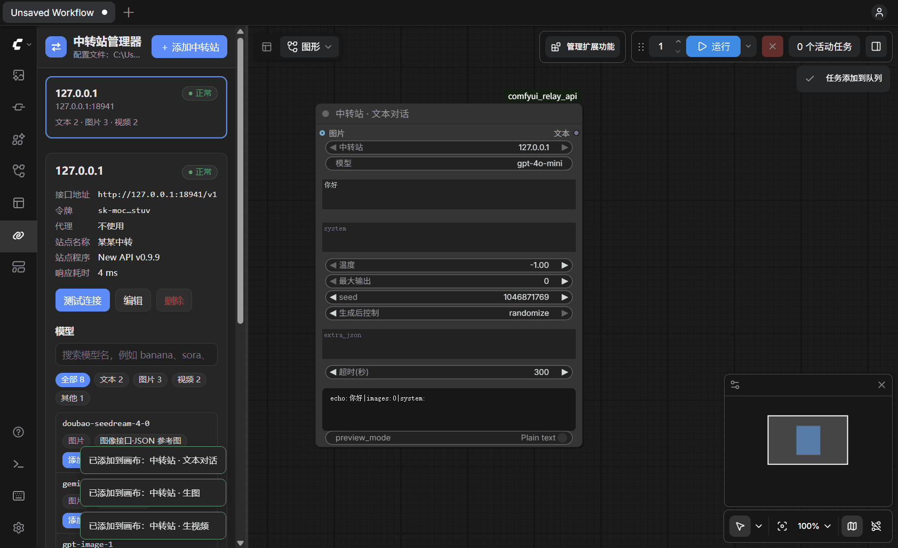

# ComfyUI 中转站 API 节点 + 中转站管理器

[English](README_EN.md)

在 ComfyUI 里通过第三方中转站调用文本、生图、生视频模型，可以同时配置多个站。自带「中转站管理器」：粘贴地址和令牌就能添加中转站，一键测试、查看模型、把配好的节点放到画布上。

适配 new-api / one-api 等搭建的 OpenAI 兼容中转站，也能接 Gemini 原生、Sora 格式和厂商原生格式。



> 这个项目只是客户端工具，不提供任何 API 或额度。令牌和费用都来自你自己的中转站，调用生图、生视频会真实扣费。

## 安装

需要本地运行的 ComfyUI（在 0.43.2 上测试过，太旧的版本加载不了节点，先更新）。不需要另外装依赖。

**方式一：ComfyUI Manager。** 打开 Custom Nodes Manager，点 Install via Git URL，填：

```
https://github.com/BennettL569/comfyui_relay_api
```

**方式二：命令行。**

```bash
cd <ComfyUI 目录>/custom_nodes
git clone https://github.com/BennettL569/comfyui_relay_api.git
```

**方式三：下载 ZIP。** 在 GitHub 页面点 Code → Download ZIP，解压到 `<ComfyUI 目录>/custom_nodes/` 里。

装好后重启 ComfyUI，左侧栏会多一个「中转站」图标（链条图标）。

**Comfy Desktop：** 要用本地实例，放进实例目录的 `ComfyUI\custom_nodes` 里。`Comfy Cloud` 跑在云端，装不了这个插件。

**更新：** 在插件目录运行 `git pull`，再重启 ComfyUI。你配置的中转站不受影响。

**卸载：** 删除插件目录。中转站配置 `relays.json` 也在里面，需要的话先备份。

## 快速开始

1. 点左侧栏的「中转站」图标，再点「添加中转站」。
2. 把站点给你的地址和令牌整段粘贴进最上面的框，会自动识别并填好。
3. 点「测试连接」确认能连上，再点「保存」。
4. 在模型列表里找到要用的模型，点「添加到画布」，画布上就多了一个配好的节点。写上提示词就能运行。

## 中转站管理器

有两种打开方式，用的是同一套界面和同一份配置：

- **ComfyUI 左侧栏的「中转站」图标：** 在 ComfyUI 里直接管理。
- **独立窗口：** 不用打开 ComfyUI 也能用。ComfyUI 开着的话，这里的修改会自动同步到节点的下拉框，「添加到画布」也会把节点放进正在打开的 ComfyUI。
  - Windows：双击 `tools\start_manager.bat`。想要桌面和开始菜单快捷方式，双击 `tools\create_shortcut.bat`。
  - macOS、Linux：运行 `sh tools/start_manager.sh`。

保存中转站后可以：

- 看到站里的模型，按文本、图片、视频分好类，并标出推荐的接口格式。鼠标停在格式标签上能看到推荐理由。
- 用搜索框和分类筛选，在很多模型里快速找到要用的。
- 文本模型可以点「测一下」，发一句话确认真的能用（花费极少）。
- 点「添加到画布」放一个配好的节点；点「复制」复制模型名，粘贴到已有节点的「模型」框。

推荐格式的依据：new-api 搭建的站会在模型列表里标注每个模型支持的接口，管理器优先按它推荐。其他站只能按模型名猜，管理器会提示这一点。

## 节点

在节点库里搜「中转站」：

| 节点 | 作用 |
|---|---|
| 中转站 · 文本对话 | 调用 `/v1/chat/completions`，接上图片就能识图、反推提示词，回复直接显示在节点上 |
| 中转站 · 生图 | 文生图、改图，参考图可以一次接多张（图片批次） |
| 中转站 · 生视频 | 文生视频、图生视频，自动轮询进度并下载成片，接「保存视频」节点即可 |
| 中转站 · 模型列表 | 列出站里有哪些模型 |

### 生图的「接口格式」

| 格式 | 请求 | 常见用法 |
|---|---|---|
| images | `/v1/images/generations`，接了参考图走 `/v1/images/edits` | gpt-image、dall-e、flux |
| images-json | `/v1/images/generations`，参考图放进 `image` 字段 | Seedream（豆包）、即梦 |
| chat | `/v1/chat/completions`，从回复里取图 | 多数站的 nano-banana 系列 |
| gemini | `/v1beta/models/{模型}:generateContent` | nano-banana 系列，可设宽高比和 1K/2K/4K |

### 生视频的「接口格式」

| 格式 | 请求 | 常见用法 |
|---|---|---|
| unified | `POST /v1/video/generations`，轮询 `GET /v1/video/generations/{task_id}` | new-api 的统一视频接口，可灵、海螺、Vidu、Seedance 等 |
| openai | `POST /v1/videos`，轮询 `GET /v1/videos/{id}`，从 `/content` 下载 | Sora 格式 |
| chat | `/v1/chat/completions`，回复里带视频链接 | 部分站的 veo、sora |
| custom | 自己填提交路径和查询路径，`{task_id}` 会被替换成任务 ID | 厂商原生格式，如可灵 `/kling/v1/videos/image2video` |
| task | `POST /v1/videos`（填了任务插件就是 `POST /v1/tasks/{插件}`），轮询 `GET /v1/tasks/{task_id}`，成片从 artifacts 下载 | new-api 的任务插件模型（模型列表里 `owned_by` 是 `task plugin`），如 MiniMax-H3。任务插件一般留空，站点会按模型自己找 |

同一个模型在不同站支持的格式可能不一样。推荐的格式不行就换一个试试，报错会带上站点返回的原因。

视频任务提交后就可能开始扣费，所以查询偶尔失败时节点会重试几次，不会重新提交；真的查不到时，报错里会带上任务 ID，可以拿它到站点后台查。

## 额外参数

节点下方的「额外参数」填 JSON 对象，会合并进请求体；值写 `null` 表示删掉该字段。例如：

- gpt-image：`{"background": "transparent", "output_format": "png"}`
- Seedream：`{"watermark": false, "response_format": "b64_json"}`
- 统一视频接口：`{"metadata": {"negative_prompt": "模糊, 变形"}}`
- 可灵原生格式（custom）：`{"model": null, "model_name": "kling-v2-1", "duration": "5"}`
- MiniMax-H3（task）：`{"metadata": {"aigc_watermark": true}}`；多模态参考用 `{"metadata": {"content": [{"type": "image_url", "image_url": {"url": "https://..."}, "role": "reference_image"}]}}`

## 配置文件

管理器改的就是插件目录下的 `relays.json`（第一次保存时创建），也可以手动编辑，格式见 `relays.example.json`：

```json
{
  "站点1": {"base_url": "https://api.example.com/v1", "api_key": "sk-...", "proxy": ""}
}
```

- `base_url` 带不带 `/v1` 都行，`proxy` 只有需要代理才能访问的站才填。
- 也可以用 `"api_key_env": "环境变量名"` 代替 `api_key`。
- 每次保存前，旧文件会备份成 `relays.json.bak`。
- 手动改完，在 ComfyUI 界面按 R 刷新节点即可，不用重启。
- 想把配置放到别处（比如几个 ComfyUI 共用一份），设环境变量 `COMFY_RELAY_CONFIG` 指向那个文件。

## 安全说明

- 令牌只存在 `relays.json` 里，不会写进工作流和图片元数据；管理器界面里只显示遮挡后的令牌。这个文件不要发给别人。`relays.json` 和它的备份都在 `.gitignore` 里，不会被提交。
- 编辑中转站时，令牌留空表示沿用原令牌；但改了接口地址或代理就必须重新填写，防止令牌被发到别的地方。
- 下载图片和视频时，只有和中转站同源的地址才带令牌。
- 管理器的接口只接受用 IP 或 localhost 访问（防 DNS 重绑定攻击）。通过域名访问 ComfyUI 的话，把域名加到环境变量 `COMFY_RELAY_ALLOWED_HOSTS`（逗号分隔）。
- 独立管理器只监听 127.0.0.1，并且每次启动生成一次性令牌。
- ComfyUI 本身没有登录验证。如果用 `--listen` 把它开放到局域网或公网，能访问 ComfyUI 的人也能用你配置的中转站发请求：他们看不到令牌，但产生的费用算你的。

## 其他说明

- seed 不会发给接口，只决定要不要重新请求：值变了才重新调用（会扣费），固定不变就复用上次结果。
- 生视频时节点上会实时显示任务状态、进度和已等待时间，随时可以点取消。
- ComfyUI 不在默认端口（8188-8197）时，独立管理器找不到它，可以设环境变量 `COMFY_RELAY_COMFY_PORTS`，例如 `8000,8188-8190`。
- 独立管理器的日志：Windows 在 `%LOCALAPPDATA%\comfyui_relay_api\manager.log`，macOS、Linux 在 `~/.local/state/comfyui_relay_api/manager.log`。
- 界面目前只有中文。

## 常见问题

| 现象 | 可能原因 |
|---|---|
| HTTP 401 / 403 | 令牌填错，或这个令牌没有该模型的权限 |
| HTTP 404 | 这个站不支持该接口格式，换一个格式试试 |
| `无可用渠道`（这一步还没生成视频，不扣费） | 不一定是渠道坏了：`/v1/video/generations` 和 `/v1/tasks/{插件}` 只找符合入口或插件键的渠道，别的渠道再好也会回这句，连不存在的模型名也一样。视频模型先改用 task 格式，任务插件留空。还不行就到站点的模型广场，看这个模型的「分组价格」里有没有你令牌的分组，或者问站长 |
| `该令牌无权访问模型`（查询任务时） | 令牌限定了模型，站点不让它查 `/v1/video/generations` 和 `/v1/videos`：取消令牌的模型限制，或者改用 task 格式 |
| 模型没有返回图片 | 模型和格式不匹配，或被内容审核拦截，看报错里的回复内容 |
| 请求超时 | 调大「超时」，视频可以设到 1800 秒以上 |
| 连不上中转站 | 网络问题，给这个站配上代理 |
| 下拉框里没有新加的站 | 在 ComfyUI 界面按 R 刷新节点 |
| 插件更新后，管理器里的模型分类还是旧的 | 开着的窗口还在用旧代码。独立窗口再打开一次就会换成新代码，旧窗口可以关掉；左侧栏的面板要重启 ComfyUI |
| 左侧栏没有「中转站」图标 | 插件不在 `custom_nodes` 里，或者 ComfyUI 还没重启。Comfy Desktop 的话确认开的是本地实例，不是 Comfy Cloud |
| 独立窗口打不开 | Windows 上 `start_manager.bat` 会提示找不到哪个文件。启动日志见上面的「其他说明」 |

## 测试

用运行 ComfyUI 的 Python，里面已经有需要的库（只跑前两个的话，装 `aiohttp av numpy pillow` 也够）：

```bash
python -X utf8 tests/test_client.py                 # 节点请求逻辑，对着本地模拟中转站，不花钱
python -X utf8 tests/test_manager.py                # 管理器：配置读写、粘贴识别、模型分类、接口安全、和 ComfyUI 联动
python -X utf8 tests/test_e2e.py <ComfyUI 目录>     # 端到端：起一个隔离的 ComfyUI 实例跑真实工作流
python -X utf8 tests/check_relays.py                # 检查 relays.json 里的站能否连通，只调免费的模型列表
```

实测情况：节点和管理器在 Windows 的 Comfy Desktop 上验证过，包括对真实中转站的文生视频。macOS、Linux 上只自动跑前两个测试，节点本身还没人实测过，遇到问题欢迎提 Issue。

## 许可证

[MIT](LICENSE)
