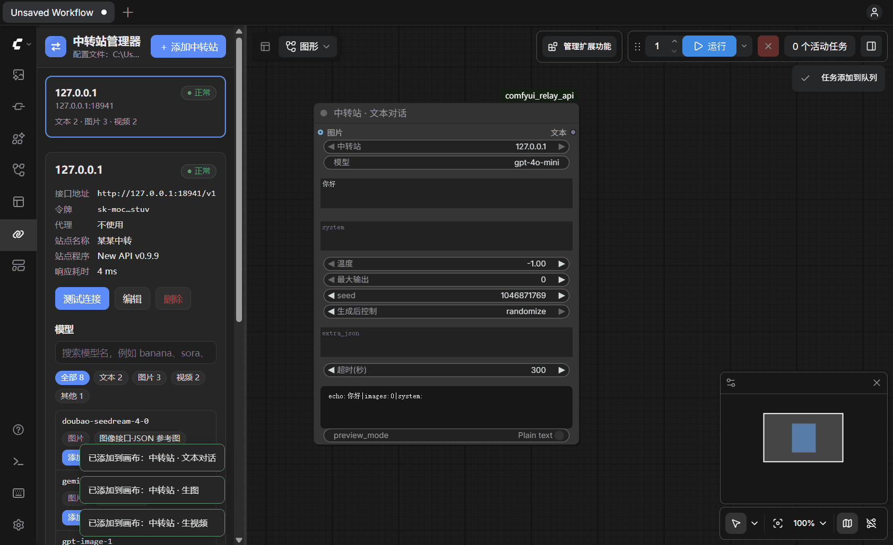

# ComfyUI Relay API Nodes + Relay Manager

[中文](README.md)

Use text, image and video models through third-party API relays in ComfyUI, with as many relays as you like. A built-in manager lets you paste an address and token to add a relay, test it, browse its models and drop a configured node onto the canvas.

It works with OpenAI-compatible relays such as those built on new-api or one-api, and also supports the Gemini native API, the Sora format and vendor-specific formats.



> This is only a client. It provides no API or credit. Tokens and charges come from your own relay, and image and video generation will really cost money.

The interface is in Chinese. Pull requests for other languages are welcome.

## Install

You need a local ComfyUI (tested on 0.43.2; update first if the nodes fail to load). There are no extra dependencies.

**ComfyUI Manager:** open the Custom Nodes Manager, choose Install via Git URL, and enter:

```
https://github.com/BennettL569/comfyui_relay_api
```

**Command line:**

```bash
cd <ComfyUI folder>/custom_nodes
git clone https://github.com/BennettL569/comfyui_relay_api.git
```

**ZIP:** on GitHub choose Code → Download ZIP and extract it into `<ComfyUI folder>/custom_nodes/`.

Restart ComfyUI. A new link icon labelled 中转站 ("relay") appears in the left sidebar.

**Comfy Desktop:** use a local instance and put the plugin in its `ComfyUI\custom_nodes` folder. Comfy Cloud cannot load this plugin.

**Update:** run `git pull` in the plugin folder and restart ComfyUI. Your relays are kept.

**Uninstall:** delete the plugin folder. It also holds your `relays.json`, so back that up first if you need it.

## Quick start

1. Open the 中转站 icon in the sidebar and click 添加中转站 (add relay).
2. Paste the address and token your relay gave you into the top box. They are detected and filled in for you.
3. Click 测试连接 (test connection), then 保存 (save).
4. Find a model in the list and click 添加到画布 (add to canvas). Write a prompt in the new node and run it.

## Standalone manager

The same manager also runs without ComfyUI. If ComfyUI is running, changes sync to it and "add to canvas" places the node there.

- Windows: double-click `tools\start_manager.bat`. Double-click `tools\create_shortcut.bat` for desktop and Start menu shortcuts.
- macOS, Linux: run `sh tools/start_manager.sh`.

## Nodes

Search for 中转站 or `relay` in the node library:

| Node | What it does |
|---|---|
| 中转站 · 文本对话 (chat) | Calls `/v1/chat/completions`. Connect an image for vision models |
| 中转站 · 生图 (image) | Text-to-image and image editing, with multiple reference images |
| 中转站 · 生视频 (video) | Text-to-video and image-to-video. Polls progress and downloads the result |
| 中转站 · 模型列表 (models) | Lists the relay's models |

**Image formats:** `images`, `images-json`, `chat`, `gemini`.

**Video formats:**

| Format | Request | Typical use |
|---|---|---|
| unified | `POST /v1/video/generations` | new-api's unified video endpoint |
| openai | `POST /v1/videos` | Sora format |
| chat | `/v1/chat/completions`, with a video link in the reply | Some relays' veo and sora |
| custom | Your own submit and query paths | Vendor-specific formats |
| task | `POST /v1/videos`, then `GET /v1/tasks/{task_id}` and artifacts | new-api task-plugin models (`owned_by: task plugin`). Leave the plugin field empty so the relay picks it |

The manager recommends a format for each model. If it fails, try another one: errors include the relay's own message.

Once a video task is submitted it may already be charged, so failed status checks are retried and the task is never resubmitted. If it still can't be checked, the error includes the task ID.

## Configuration

The manager edits `relays.json` in the plugin folder, created the first time you save. You can also edit it by hand (see `relays.example.json`) and press R in ComfyUI to refresh:

```json
{
  "my-relay": {"base_url": "https://api.example.com/v1", "api_key": "sk-...", "proxy": ""}
}
```

Use `"api_key_env": "ENV_VAR_NAME"` instead of `api_key` to read the token from an environment variable, or set `COMFY_RELAY_CONFIG` to keep the file elsewhere.

## Security

- Tokens stay in `relays.json`. They are not written to workflows or image metadata, and the manager only shows them masked. Don't share this file. It and its backup are in `.gitignore`.
- Tokens are only sent to the relay's own origin when downloading results.
- The standalone manager listens on 127.0.0.1 only and uses a one-time token per launch.
- ComfyUI itself has no login. If you expose it with `--listen`, anyone who can reach it can send requests through your relays. They can't see your tokens, but the charges are yours.

## Tests

Use the Python that runs ComfyUI (`aiohttp av numpy pillow` are enough for the first two):

```bash
python -X utf8 tests/test_client.py
python -X utf8 tests/test_manager.py
python -X utf8 tests/test_e2e.py <ComfyUI folder>
python -X utf8 tests/check_relays.py   # free, read-only check of your configured relays
```

The nodes and manager have been verified on Comfy Desktop on Windows, including text-to-video against a real relay. On macOS and Linux only the first two tests run automatically, and the nodes themselves are untested. Please open an issue if you hit a problem.

## License

[MIT](LICENSE)
